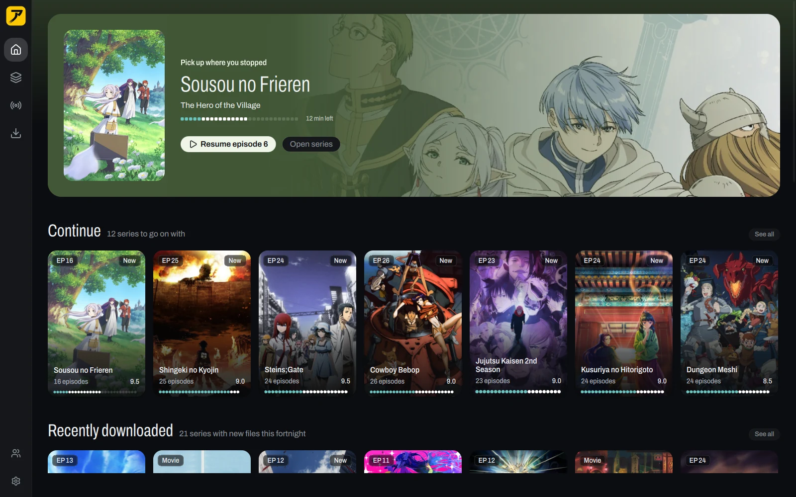
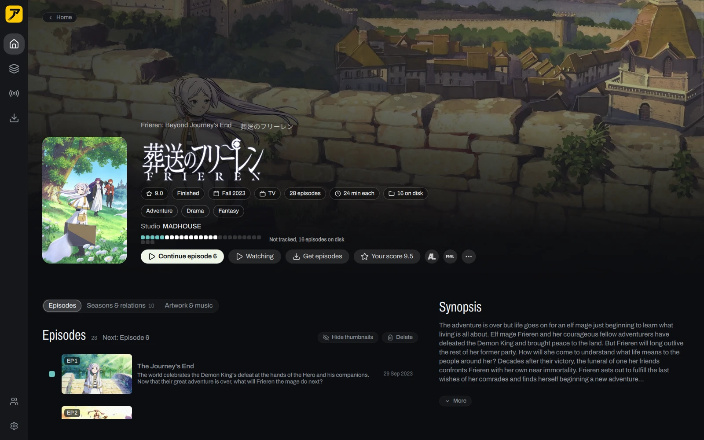
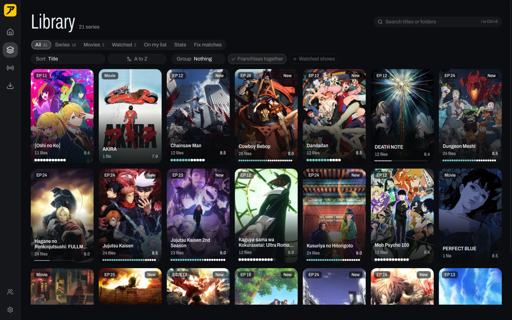
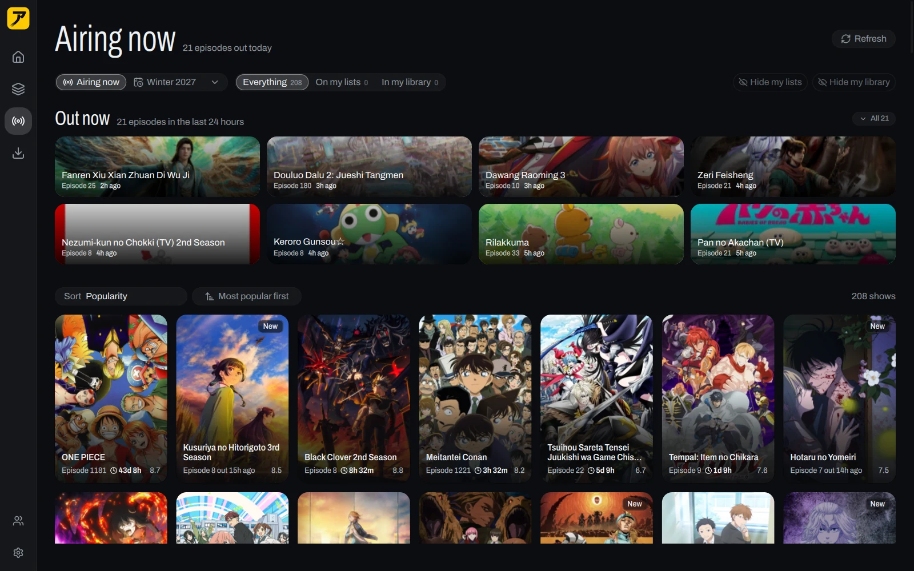
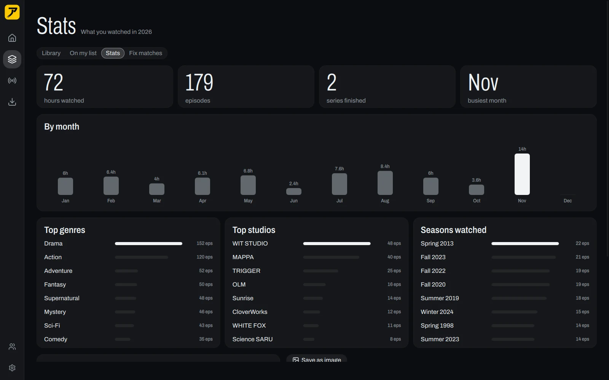

<div align="center">

<picture>
  <source media="(prefers-color-scheme: dark)" srcset="docs/readme/wordmark-dark.svg">
  
</picture>

<br>
<br>

**A local anime library, player, and tracker for desktop and mobile.**

**[anibeam.app](https://anibeam.app)** · **[Wiki](https://anibeam.app/wiki/)** · **[What's new](https://anibeam.app/whats-new/)** · **[Watch together](https://rooms.anibeam.app/)**

<br>

[](https://github.com/marcusbandit/Anibeam/releases/latest)
[](https://github.com/marcusbandit/Anibeam/releases)
[](https://github.com/marcusbandit/Anibeam/releases?q=android&expanded=true)
<br>
[](#install)
[](https://github.com/marcusbandit/Anibeam/releases)
[](LICENSE)
[](https://ko-fi.com/marcusbandit)

</div>

<br>

<div align="center">

</div>

<br>

Point Anibeam at your anime folder to organize, watch, and track your collection in one app.
It matches shows on AniList (with TVmaze as a fallback), fetches posters, episode lists, and
airing schedules, plays episodes with a built-in mpv player, and syncs your progress to
AniList and MyAnimeList.

No media server, account, or telemetry required. Desktop builds for Linux, Windows, and
Apple silicon Macs bundle the player and a built-in qBittorrent client for optional automatic
downloads. The Android app runs on its own. An iPhone app is in the works as an early preview.

## Features

- **Automatic library and matching.** Scans your folders, watches for new files, matches shows
  on AniList and TVmaze, fetches posters, IMDb scores, and airing times, and groups franchises
  together with a Related section on each show page.
- **Built-in mpv player and TV casting.** Remembers resume points, skips intros and outros
  (via AniSkip and chapter markers), supports custom subtitle styling and audio/subtitle
  delay, and casts to Chromecast and DLNA TVs.
- **Tracking, stats, and recommendations.** Two-way sync with AniList and MyAnimeList
  (progress, scores, list status, dates, rewatches, and notes), or local-only tracking without
  an account. Includes watching stats, year recap, personalized recommendations on Home, and
  Discord Rich Presence.
- **Watch together.** Start a synced room from any episode and invite up to 10 friends with a
  six-letter code, a `rooms.anibeam.app` link, a QR code, or Discord. Everyone plays their own
  copy in sync, with opening-based offset alignment and one-click episode fetching for friends
  who don't have the file yet.
- **Airing schedule and downloads.** Browse current and past seasons, export an iCal airing
  schedule, search releases across signed source lists you add (RSS, Torznab/Prowlarr/Jackett,
  and JSON), subscribe to airing shows, and use rolling downloads to keep long shows a few
  episodes ahead while optionally cleaning up watched files.
- **Themes and languages.** 35 built-in themes (including Catppuccin, Gruvbox, Tokyo Night,
  and Nord), dark/light/system mode, custom accent and text size, and 13 languages.
- **Phone app.** Works on its own with a local library, built-in torrent engine, and libmpv
  playback. It also streams from your computer over Tailscale with automatic transcoding and
  per-person progress. The Android app is ready, and the iPhone app is an early preview.

<table>
  <tr>
    <td width="50%"></td>
    <td width="50%"></td>
  </tr>
  <tr>
    <td align="center"><sub>Series page</sub></td>
    <td align="center"><sub>Library</sub></td>
  </tr>
  <tr>
    <td width="50%"></td>
    <td width="50%"></td>
  </tr>
  <tr>
    <td align="center"><sub>Airing now</sub></td>
    <td align="center"><sub>Stats</sub></td>
  </tr>
</table>

## Install

Install on Linux or macOS with one command:

```sh
curl -fsSL https://anibeam.app/install.sh | sh
```

The script uses your package manager on Arch, Ubuntu, Debian, Fedora, and Macs with Homebrew. Everywhere else, it uses the AppImage or the `.dmg`. You can [read the script first](https://anibeam.app/install.sh).

On Windows and Android, download the right build for your device from **[anibeam.app/download](https://anibeam.app/download/)**. All builds are also available on [GitHub Releases](https://github.com/marcusbandit/Anibeam/releases/latest).

> [!NOTE]
> **The iPhone app is not finished.** It is an early preview that still uses the Android app's interface while a native iPhone interface is being built. You sideload it yourself. Expect rough edges.

### By platform

<details>
<summary><b>Arch Linux</b></summary>

<br>

```sh
yay -S anibeam-bin
```

`anibeam-bin` installs the prebuilt package. Use `anibeam` to build from source instead.

</details>

<details>
<summary><b>Ubuntu 24.04+ and Debian 13+</b></summary>

<br>

```sh
sudo curl -fsSLo /etc/apt/sources.list.d/anibeam.sources \
  https://anibeam.app/apt/anibeam.sources &&
sudo apt update && sudo apt install anibeam
```

Run `apt upgrade` for updates.

</details>

<details>
<summary><b>Fedora 41+</b></summary>

<br>

```sh
sudo dnf config-manager addrepo \
  --from-repofile=https://anibeam.app/rpm/anibeam.repo &&
sudo dnf install anibeam
```

Run `dnf upgrade` for updates.

</details>

<details>
<summary><b>Other Linux</b>: AppImage, .deb or .rpm</summary>

<br>

The install script above puts the AppImage in `~/.local/bin` and adds a menu entry. To install it manually, download `Anibeam-<version>-x86_64.AppImage` from [Releases](https://github.com/marcusbandit/Anibeam/releases/latest) and run it:

```sh
chmod +x Anibeam-*-x86_64.AppImage && ./Anibeam-*-x86_64.AppImage
```

The AppImage requires glibc 2.39 or newer, which means Ubuntu 24.04, Debian 13, Fedora 40, or newer. If you see a FUSE error, install `libfuse2`, or `libfuse2t64` on Ubuntu 24.04. You can also start it with `--appimage-extract-and-run`. The release also has `.deb` and `.rpm` packages.

</details>

<details>
<summary><b>macOS 15+</b> on Apple silicon</summary>

<br>

Install with Homebrew:

```sh
brew tap marcusbandit/anibeam https://github.com/marcusbandit/Anibeam &&
brew install --cask marcusbandit/anibeam/anibeam
```

Or download the `.dmg` from [Releases](https://github.com/marcusbandit/Anibeam/releases/latest) and drag Anibeam into your Applications folder.

The Mac build is not notarized, so macOS blocks the first launch. Open **System Settings > Privacy & Security**, scroll to the Anibeam notice, and click **Open Anyway**. Or run:

```sh
xattr -dr com.apple.quarantine /Applications/Anibeam.app
```

</details>

<details>
<summary><b>Windows 10 and 11</b></summary>

<br>

Download `Anibeam-<version>-windows-x64-setup.exe` from [anibeam.app/download](https://anibeam.app/download/) or [Releases](https://github.com/marcusbandit/Anibeam/releases/latest). It installs for your user account only and needs no admin prompt. A portable `.zip` is available alongside it.

The installer is unsigned, so Windows SmartScreen may block it. Click **More info**, then **Run anyway**.

</details>

<details>
<summary><b>Android 8+</b></summary>

<br>

Download `Anibeam-<version>.apk` from the latest [Android release](https://github.com/marcusbandit/Anibeam/releases?q=android&expanded=true) and open it on your phone. Android will ask once for permission to install apps from your browser or file manager.

</details>

<details>
<summary><b>iPhone</b>: early preview, sideloaded</summary>

<br>

Add the Anibeam source to your sideloading app. You get Anibeam and Anibeam Nightly side by side, and both stay updated from there:
[AltStore](https://anibeam.app/install/?to=altstore&source=1) · [SideStore](https://anibeam.app/install/?to=sidestore&source=1) · [LiveContainer](https://anibeam.app/install/?to=livecontainer&source=1)

Or install a single IPA without adding the source:

- Stable: [AltStore](https://anibeam.app/install/?to=altstore&channel=stable) · [SideStore](https://anibeam.app/install/?to=sidestore&channel=stable) · [LiveContainer](https://anibeam.app/install/?to=livecontainer&channel=stable)
- Nightly: [AltStore](https://anibeam.app/install/?to=altstore&channel=nightly) · [SideStore](https://anibeam.app/install/?to=sidestore&channel=nightly) · [LiveContainer](https://anibeam.app/install/?to=livecontainer&channel=nightly)

Requires iOS 17 or newer. The IPA is unsigned, and your sideloading app signs it. If a channel has no IPA yet, the install page says so.

</details>

<details>
<summary><b>Nightly builds</b></summary>

<br>

Install the latest nightly on Linux or macOS:

```sh
curl -fsSL https://anibeam.app/install.sh | ANIBEAM_CHANNEL=nightly sh
```

Nightly builds use the AppImage on Linux and the `.dmg` on macOS, since AUR, apt, dnf, and Homebrew carry stable releases only. On Windows, download a nightly build from [Releases](https://github.com/marcusbandit/Anibeam/releases).

</details>

The AppImage, Windows, and macOS builds update themselves. Switch between Stable and Nightly anytime in **Settings > About**. AUR, apt, and dnf installs update through your system package manager.

Want to inspect the code or have an AI agent review it before installing? [docs/safety-audit.md](docs/safety-audit.md) maps every installer, network host, credential store, subprocess, local listener, and CI build workflow, with commands to verify the whole tree. See also [Privacy](https://anibeam.app/privacy/) and [SECURITY.md](SECURITY.md).

## Getting started

On first launch, Anibeam walks you through a short setup (every step is optional, and you can re-run it anytime under **Settings > About > Run setup again**):

1. **Add your library folder.** Pick the parent folder that holds your shows. One folder per show works best (`Anime/Sousou no Frieren/Frieren - 01.mkv`), and movies go in a `Movies` folder. Manage folders anytime in **Settings > Library**.
2. **Connect a tracker (optional).** Go to **Settings > Accounts** to sign in to AniList or MyAnimeList in your browser.
3. **Watch.** Click any show, then an episode. Press `?` in the player to see all keyboard shortcuts.
4. **Set up downloads (optional).** Anibeam ships with no download sources. Paste a signed source list URL in **Settings > Downloads > Source lists** (or directly on the **Downloads** page) to enable its sources, then click **Get episodes** on any show or search in **Downloads** to download or subscribe.

If a show isn't recognized or matched wrong, open it and click **Fixes > Match** (or review unmatched shows in **Library > Fix matches**). Misread episode files can be corrected under **Fixes > Files**.

<details>
<summary><b>More on downloads</b></summary>

<br>

Anibeam runs its own built-in search and subscription engine and bundles a headless qBittorrent client. The built-in client starts automatically when needed and stays running after you close Anibeam so subscriptions keep downloading.

By default, the built-in client saves episodes straight into your library folder (one folder per show, movies in `Movies`), so finished downloads show up in your library automatically. You can pick a different folder in **Settings > Downloads > Save to**.

To use your own qBittorrent instance (local, remote, or seedbox), enable its Web UI in qBittorrent (**Tools > Options > Web UI**), then go to **Settings > Downloads > Torrent client**, set **Which client** to **My own**, enter your address and login, and click **Save and test**. Make sure its download directory is added under **Settings > Library**.

See the [Downloads](https://anibeam.app/wiki/downloads/) and [Sources](https://anibeam.app/wiki/sources/) wiki pages for details on source lists and rolling downloads.

</details>

## Sources

Anibeam ships no download sources and links to no list of them. Instead, downloads read source lists: signed files of source definitions that anyone can publish. Add one by URL in **Settings > Downloads > Source lists**. Each definition is plain data and runs no code. When you add a list, Anibeam shows its signing key and refuses any later update signed with a different key.

There are two ways to help:

- **Publish a source list.** Start from [anibeam-endpoints-template](https://github.com/marcusbandit/anibeam-endpoints-template). Click **Use this template**, replace the examples with your own definitions, add your own signing key, and share the URL anywhere. The template's README explains the format. On Linux and Android, an `anibeam://add-repo?url=<your list's URL>` link lets people add your list in one click.
- **Ask for a new kind of input.** Anibeam reads RSS feeds, torznab APIs, and JSON feeds. If a feed uses another format, [open an issue](https://github.com/marcusbandit/Anibeam/issues/new) describing its structure.

Please don't name or link a site, or a list of sites, in an issue or pull request here. Which sources exist is up to the people who publish lists, not this project.

## Phone app and Tailscale streaming

The phone app works standalone with its own local library, built-in torrent engine, and libmpv playback, syncing to the same AniList or MyAnimeList account.

It can also browse and stream your computer's library from anywhere over [Tailscale](https://tailscale.com) with automatic transcoding and per-person progress: sign in to Tailscale on both devices, then turn on **Settings > Accounts > Phone app > Share over Tailscale** on your computer. Only devices on your tailnet can connect. To keep sharing when the desktop window is closed, run `anibeam serve` (or enable the `anibeam-host` systemd user service on Linux). See [apps/phone/README.md](apps/phone/README.md) for full details.

## Troubleshooting

<details>
<summary><b>qBittorrent won't connect</b></summary>

<br>

Open **Settings > Downloads > Torrent client**, click **Test**, and check **Details** for the exact error. If you want Anibeam to manage qBittorrent automatically, switch **Which client** to **Built-in** (or **Auto**) and save.

</details>

<details>
<summary><b>Tracker sign-in stays on "Finish in your browser"</b></summary>

<br>

Approve Anibeam in the browser tab it opened. If you closed that tab, click **Open the sign-in page again**.

</details>

<details>
<summary><b>Where Anibeam stores its data</b></summary>

<br>

| Platform | Data and config | Credentials | "Use my mpv.conf" reads |
| --- | --- | --- | --- |
| Linux | `~/.local/share/anibeam`, `~/.config/anibeam` | Secret Service keyring (or an owner-only file) | `~/.config/mpv/mpv.conf` |
| macOS | `~/Library/Application Support/anibeam` | macOS Keychain | `~/.config/mpv/mpv.conf` |
| Windows | `%LOCALAPPDATA%\anibeam`, `%APPDATA%\anibeam` | Windows Credential Manager | `%APPDATA%\mpv\mpv.conf` |

You can view the exact paths and export or restore a full backup in **Settings > About**.

</details>

Check the [Troubleshooting wiki](https://anibeam.app/wiki/troubleshooting/) for more fixes, or use **Settings > About > Report a problem** to [open an issue](https://github.com/marcusbandit/Anibeam/issues/new/choose) with your version pre-filled.

## Build from source

Run `./build.sh` from a checkout to build the desktop app. See [docs/build-from-source.md](docs/build-from-source.md) for dependencies, dev runs, and the CLI. Logos live in [assets/logo/](assets/logo/), and [CONTRIBUTING.md](CONTRIBUTING.md) covers issues, pull requests, and releases.

## Support

Anibeam is free and open source. If you get good use out of it and want to support development, you can buy me a coffee on [Ko-fi](https://ko-fi.com/marcusbandit). Completely optional, and starring the repo or filing good bug reports helps just as much.

<div align="center">

[](https://ko-fi.com/marcusbandit)

</div>

## Credits

- [AniList](https://anilist.co), [TVmaze](https://www.tvmaze.com), [IMDb](https://www.imdb.com), and [AniSkip](https://aniskip.com) for metadata, ratings, and skip times; [MyAnimeList](https://myanimelist.net) for tracking.
- [mpv](https://mpv.io) and KDE's [MpvQt](https://invent.kde.org/libraries/mpvqt) for video playback; [Qt](https://www.qt.io) (desktop) and [Slint](https://slint.dev) (mobile) for the UI.
- [qBittorrent](https://www.qbittorrent.org) and [librqbit](https://github.com/ikatson/rqbit) for downloads.

## License

[GPL-3.0](LICENSE).
